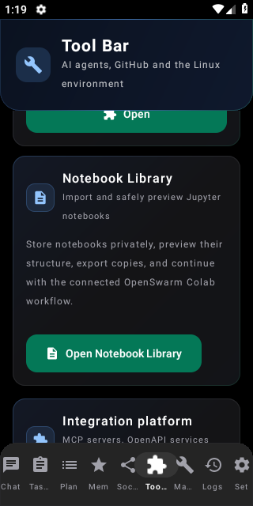
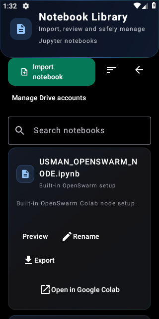
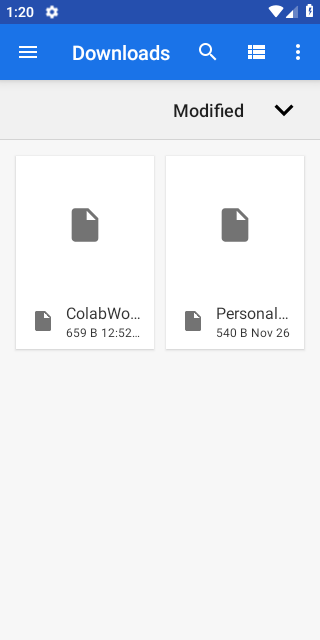
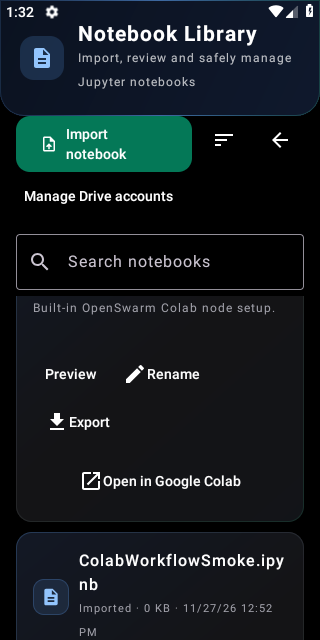
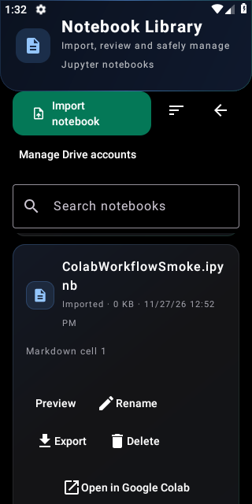
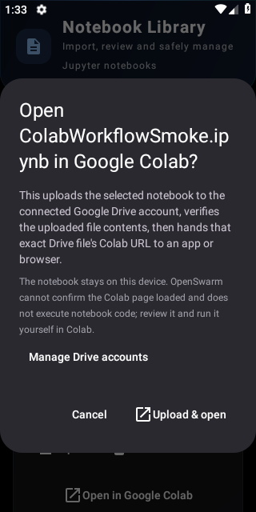
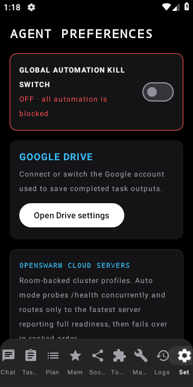
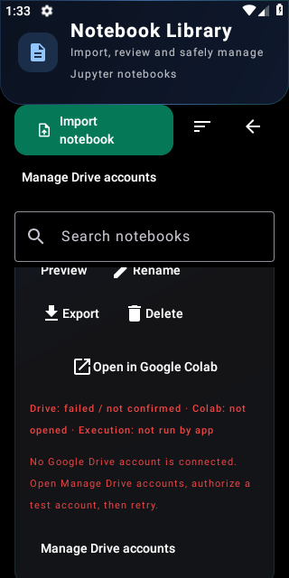

# Personal Notebook → Google Colab Workflow: Test Evidence

**Run date:** 27 November 2026
**Repository:** `saedhawwa23-rgb/usman-and-umar-app`
**Branch:** `feature/hybrid-task-orchestrator`
**Starting revision:** `fb1c192f42ac0ab60b749bec7e80c409b2c34ccb`

## Implementation covered

The Notebook Library now offers a per-notebook **Open in Google Colab** action with explicit upload/open consent. The app reads the selected local `.ipynb` bytes, validates the notebook structure and size, uploads those bytes without reconstructing notebook JSON, verifies the resulting Drive file metadata and content, and derives the Colab URL from that verified Drive file ID. An identical existing file can be reused only after verification; name collisions with different content are uploaded under a free suffixed name rather than overwritten. Upload, verification, Android link handoff, and execution are represented separately. The app itself does not execute notebook code.

## Regression, lint, and build results

- `:app:testDebugUnitTest`: **1,069 tests; 0 failures; 0 errors; 7 skipped**.
- `:app:lintDebug`: succeeded. The run reported one hint, nine findings filtered by the existing lint baseline, and one stale baseline entry. The source still has icon deprecation warnings.
- `:app:assembleDebug`: succeeded.
- `:app:assembleRelease -PallowUnsignedRelease=true`: succeeded as an **unsigned diagnostic build only**.
- A normal `:app:assembleRelease` was re-run and correctly refused because the permanent signing inputs are absent. No replacement key was generated.
- `git diff --check`: succeeded with no whitespace errors.

## API 28 evidence

The final debug APK was installed and exercised on an Android API 28 emulator. The screenshots show the Tools entry, Notebook Library, Android document picker, imported notebook, per-notebook action, consent, Drive settings entry, and missing-account result:

The fixture [`ColabWorkflowSmoke.ipynb`](ColabWorkflowSmoke.ipynb) is explicitly labeled synthetic and not a personal notebook. It is 659 bytes, valid nbformat 4, with one Markdown cell and one code cell. After import into the final API 28 build, the app-private stored copy was extracted and compared: source and stored SHA-256 both equal `5b79f3ff9e7df600a141b4d55297d8d3e53ad2940cd8415d449de5ad5a15d15c`. The app preview displayed its Markdown cell. This verifies import, local storage, structure, and byte preservation; it does **not** verify Colab execution.

When the consent flow was exercised, the emulator showed **no Google Drive account connected**. The app stopped with Drive marked failed/not confirmed, Colab not opened, and execution not run by the app. It provided the Manage Drive accounts recovery path. Therefore, no live Drive upload, Drive content read-back, Colab page load, notebook execution, or OpenSwarm-to-Colab connectivity test was performed. Those acceptance checks still require an authorized test account and a live follow-up run. The Drive API contract tests use MockWebServer and cover exact multipart bytes, verification, duplicate handling, verification mismatch, HTTP failure, and network failure; they are not a substitute for live account testing.

## APK identity and fingerprints

Both artifacts report package `com.usmanandumar.app`, versionCode `46`, versionName `3.14.1-remote-live-view`, min SDK `28`, target SDK `36`, and ABIs `arm64-v8a`, `armeabi-v7a`, `x86`, and `x86_64`.

| Artifact | SHA-256 | Signing result |
|---|---|---|
| `app/build/outputs/apk/debug/app-debug.apk` | `4e3a8fa0ccadaef213a7a398a7619a4ae2f9dbe22b34485661fe8a02919f414c` | Verified with Android debug certificate; certificate SHA-256 `7c4da2ba8a7272ff4e9981943971958d428b544fff264c93aa1caa3744aee177` |
| `app/build/outputs/apk/release/app-release-unsigned.apk` | `a8487fff7def5dee4ae89122af3e6c0e8a72ca9e6dc2af92524d03f8d15b3908` | Unsigned diagnostic; signature verification correctly fails; **not for distribution** |

Release signing remains blocked until the project’s permanent `opendroid-release.keystore` and its `RELEASE_STORE_PASSWORD`, `RELEASE_KEY_ALIAS`, and `RELEASE_KEY_PASSWORD` are configured. A public GitHub Release was not created.
