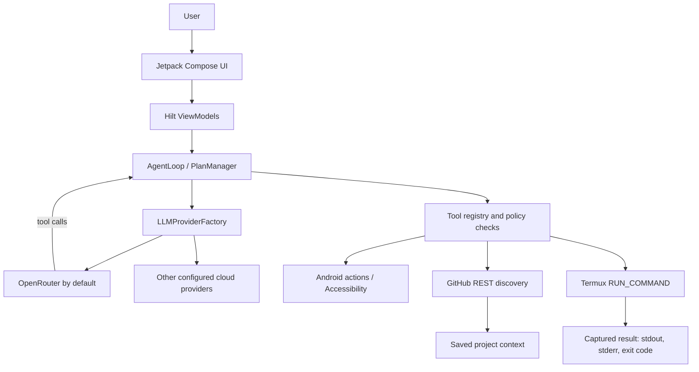

# USMAN AND UMAR — Cloud-First Android Architecture

This document describes the current `3.6.0` application. The app uses configured cloud LLM providers for reasoning; it does not bundle a local LLM or model artifact.

## 1. Architecture at a glance

The main layers are:

- **Presentation:** Compose screens and Hilt ViewModels expose UI state with `StateFlow`.
- **Agent/core:** `AgentLoop`, plan/re-evaluation logic, `CloudToolAgent`, registered connector tools, action-risk checks, and user approval boundaries.
- **Provider/data:** `LLMProviderFactory`, provider implementations, repository APIs, Room, DataStore, and protected credential storage.
- **Android boundary:** Accessibility, system intents, runtime permissions, background work, and optional Termux integration.

## 2. Cloud reasoning and tool calling

OpenRouter is the default for new installs. Other supported providers can be selected/configured in Settings. The factory constructs the active cloud provider; no local inference engine is a fallback provider.

The OpenAI-compatible tool cycle is:

1. Send the conversation plus registered tool schemas to the selected model.
2. Parse assistant `tool_calls` and validate each requested tool against the app's registry and policy.
3. Execute only authorized tools through the app's connector/action layer.
4. Append the assistant tool-call message and matching tool result messages, preserving call IDs.
5. Request the model's final natural-language response.

A provider's model catalog response does **not** prove that credentials, completion, or tool calling work. Tool availability and quality depend on the selected model. Provider errors are normalized to redacted, user-safe diagnostics; credentials, prompts, and raw response bodies are not included in those error details.

For high-impact actions, provider fallback is not an authorization bypass. Existing action approval and risk policies remain authoritative.

## 3. GitHub project discovery

`DiscoveryRepository` uses public GitHub REST endpoints for repository search, metadata lookup, README retrieval, and root contents. It handles 403/429 as rate-limit errors and 404 as missing/private repository responses. These requests are unauthenticated and only promise public repository information.

`DiscoveryViewModel` keeps the interaction explicit:

- **Search:** calls GitHub's repository search endpoint with the user's query.
- **Open:** fetches live repository metadata, README text, and root entries; it does not change saved project state.
- **ADD:** stores repository metadata in the user's project list.
- **USE:** stores the metadata and sets its repository ID as the active project context.
- **Clone:** passes a validated public HTTPS GitHub URL to Termux; this is a separate command execution step.

The project library is app settings data. GitHub lookup does not imply that a repository has been cloned, executed, or trusted.

## 4. Termux command execution

Termux is an optional, separately installed execution backend; it is not an LLM. `TermuxIntegration` sends the documented `com.termux.RUN_COMMAND` intent to Termux's `RunCommandService` only after checking installation and `com.termux.permission.RUN_COMMAND`. Termux must also have `allow-external-apps=true` enabled.

Commands are passed as an executable and argument array, not shell-interpolated strings. GitHub clone URLs are parsed and constrained to `https://github.com/owner/repository` before the `git clone` argv is assembled. Each run receives a unique request ID and callback `PendingIntent`; the result receiver reads Termux's nested `result` bundle and records stdout, stderr, exit code, and any startup error. Termux 0.109+ is required for callback results.

The callback contract and safe clone-argument construction have JVM tests. A real command and clone on an installed, permission-granted Termux app remain **UNVERIFIED — REQUIRES DEVICE**.

## 5. Data and security boundaries

- Provider API keys are stored through the app's protected credential store; never commit keys or release signing credentials.
- Cloud requests are sent over HTTPS to the explicitly selected provider. User prompts and any included context are therefore transmitted to that provider for inference.
- Android actions remain permission-gated. Accessibility and runtime grants are controlled by Android settings and the user.
- Termux execution is dispatched only through the explicit Termux API and its Android permission; the app does not simulate a shell inside the AI runtime.
- GitHub lookups are public-only in this flow; private repository credentials are not requested or inferred.

## 6. Retired local inference

The current app has no bundled GGUF model, llama.cpp Gradle module, local inference JNI bridge, LiteRT LLM provider, or model download/import screen. The two small native libraries present in the APK are transitive Android library components, not an LLM engine or bundled model. The old Qwen implementation note is retained only as an archived retirement notice in [`qwen3-migration.md`](qwen3-migration.md).

## 7. Build and verification

- Minimum Android version: API 28 (Android 9).
- Target SDK: API 34.
- Version: `3.6.0`, versionCode 24.
- JVM suite: `./gradlew :app:testDebugUnitTest`.
- Unsigned validation release: `./gradlew clean :app:assembleRelease -PallowUnsignedRelease=true`.

JVM tests and APK inspection cannot validate manufacturer-specific behavior, Android permissions on a real device, or the Termux external-command handshake. All such device-level checks are explicitly **UNVERIFIED — REQUIRES DEVICE** until executed on the intended phone.
